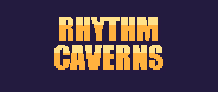

<p align="center"></p>

Juego de ritmo para **Game Boy Advance**, hecho con [Butano](https://github.com/GValiente/butano).
Los enemigos llegan por los cuatro carriles de una arena: golpealos con la
cruceta justo cuando pisan el anillo, al ritmo de la música. Probado en
hardware real (GBA SP).

## Qué tiene

- **9 canciones** × 4 dificultades con progresión por carriles: FACIL usa un
  solo carril para aprender el timing, y cada escalón suma uno hasta MUY
  DIFICIL con los cuatro. Cada combinación canción+dificultad tiene su
  propio chart, con récord, rango (S/A/B/C) y estrella de full combo
  guardados en SRAM.
- **Tempo real por canción**, leído del header de cada módulo tracker.
- **Ráfagas** (filas de 3 enemigos): se revientan tocando la cruceta 3 veces,
  estilo Muse Dash / Radio Hammer.
- **Euforia**: con el medidor lleno, A activa puntos dobles por un rato.
- **Corazón curativo** a mitad de canción (de NORMAL hacia arriba): se
  golpea como un enemigo y cura una vida.
- **Zonas con identidad**: sets de enemigos, héroe y color de fondo según la
  canción (mazmorra, pradera, cripta) — y una canción **BOSS** que siempre
  juega un escalón de dificultad más arriba.
- Menú de pausa, calibración de latencia (CONFIGURACION) y pantalla de
  resultados con precisión.

## Controles

| Botón | Acción |
|---|---|
| Cruceta | Golpear hacia ese carril / navegar menús |
| A | Activar euforia (medidor lleno) · confirmar en menús |
| B | Volver / continuar desde la pausa |
| START | Pausa · confirmar en menús |
| L / R | Cambiar dificultad en la selección de canción |

## Compilar

Requisitos: [devkitPro](https://devkitpro.org/wiki/Getting_Started) con el
componente GBA, y el motor Butano clonado **al lado** de esta carpeta:

```
tu-carpeta/
├── butano/            ← git clone --depth 1 https://github.com/GValiente/butano.git
└── Rhythm-Caverns/    ← este repo
```

```
cd Rhythm-Caverns
make
```

Genera `Rhythm-Caverns.gba`; se abre con [mGBA](https://mgba.io) o se carga
en un flashcart. Notas:

- **Cerrar mGBA antes de recompilar** (si tiene el `.gba` abierto, el build
  falla con `objcopy: Invalid argument`).
- Si `make` no encuentra el toolchain: `make DEVKITPRO=/c/devkitPro DEVKITARM=/c/devkitPro/devkitARM`.
- El primer build compila el motor completo y tarda varios minutos.
- Si se renombra o mueve la carpeta, borrar `build/` (guarda rutas absolutas).

Los fondos pintados (arena, tarjeta, logo, piso de mazmorra) y los sprites
convertidos se regeneran con los scripts de `assets-src/` (Python 3 + Pillow);
cada uno deja un `*_preview.png` para mirar el resultado sin compilar.

## Créditos de assets

- **Música** (`audio/*.it`): "Haydenwoffle .it Soundtrack" por Spring +
  VinsCool, CC0 ([OpenGameArt](https://opengameart.org/content/haydenwoffle-it-soundtrack)),
  más `minor_boss_r.it` por Spring/Spring Enterprises, CC-BY 4.0
  ([OpenGameArt](https://opengameart.org/content/minor-boss-r)).
- **Arte** (héroes, enemigos y tiles): "Super Gameboy Quest" por
  [Toadzillart](https://toadzillart.itch.io/) (packs
  [Dungeons](https://toadzillart.itch.io/dungeons-pack) y
  [Monsters](https://toadzillart.itch.io/monster-pack)), uso permitido
  citando al autor.
- **SFX** (`audio/sfx_*.wav`): "The Essential Retro Video Game Sound Effects
  Collection" por Juhani Junkala / SubspaceAudio, CC0
  ([OpenGameArt](https://opengameart.org/content/512-sound-effects-8-bit-style)).

Los créditos también están dentro del juego (menú principal → CREDITOS).
